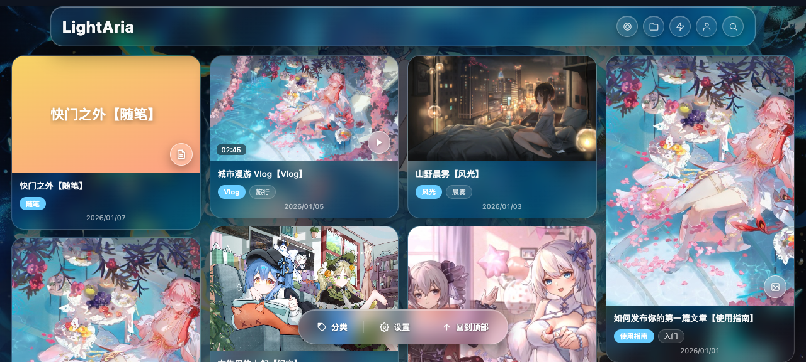
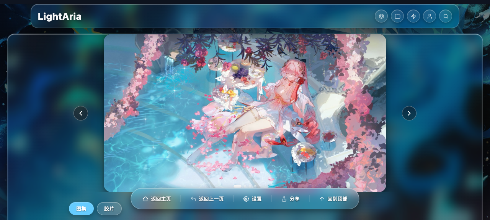
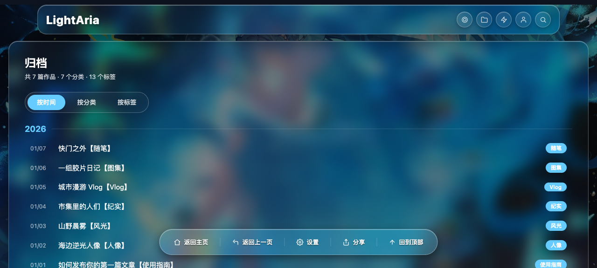
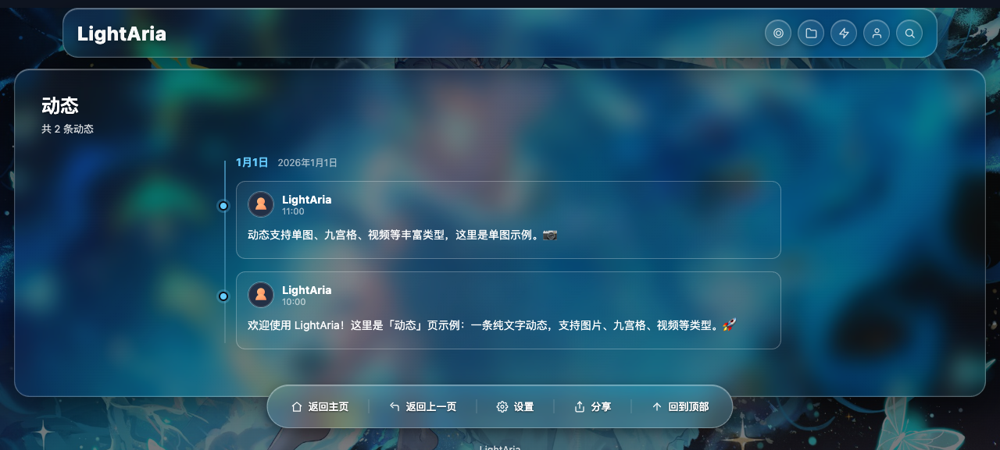
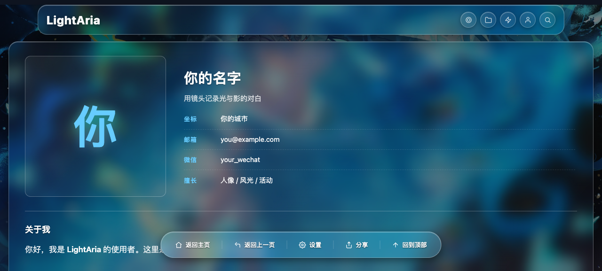

# 重要声明：本项目AICoding含量高达99.9%，存在一定的未知bug和不完善的地方，仅供个人学习使用。当前是预览版本，欢迎反馈与提交Pull Request。
# LightAria 

## TODO
* 人工复审
* 跨平台可视化管理软件

一个开箱即用的**摄影作品集静态博客**，基于 [Astro](https://astro.build) 构建，液态玻璃（Glassmorphism）视觉风格，深色沉浸式体验，适配手机与桌面端。可用于展示传媒作品集静态博客





### 更多页面







## ✨ 特性

- 📱 **小红书式信息流**：网格瀑布流 / 列表 / 简洁三种布局，桌面与手机可分别设置
- 🖼 **图集模式**：`type: photo` 且 `images` 非空时渲染图集区域，多张图片支持左右滑动轮播（触摸滑动 + 箭头 + 圆点）
- 🎬 **视频模式**：文章顶部视频播放器，卡片显示播放按钮与时长
- 🧊 **液态玻璃视觉**：半透明模糊卡片、深色沉浸式无边框观感、柔和光影
- 🎨 **一键换肤**：主题色、背景图、玻璃模糊度、背景亮度、字号全部可在设置面板调节并本地记忆
- 🏷 **智能分类**：标题 `【分类】` 自动识别，或 `category` 字段显式指定
- 📑 **归档三视图**：按时间 / 按分类 / 按标签筛选
- 💬 **动态页**：纯文字 / 单图 / 九宫格 / 视频等动态类型
- 🔗 **友情链接 / 个人主页**：预留完善的展示页
- 🌐 **快速分享**：一键生成分享卡片（封面 + 标题 + 二维码）
- ⚡ **性能**：图片懒加载 + 加载淡入，滚动流畅无闪动

## 🚀 快速开始

```bash
npm install       # 安装依赖
npm run dev       # 本地开发 http://localhost:4321
npm run build     # 构建静态站点（输出 dist/）
npm run preview   # 本地预览构建产物
```

部署：将 `dist/` 目录部署到任意静态托管平台（Cloudflare Pages / Netlify / Vercel / 自有服务器）。

> ⚠️ 部署前请先把 `astro.config.mjs` 里的 `site` 从 `https://example.com` 改成你的正式域名，否则 canonical / OG / sitemap 都会指向错误地址。

## 📝 发布文章

在 [作品内容目录](<src/content/works/>) 下新建 `.md` 文件，可直接放在目录下，也可使用子文件夹整理。**文件夹名不会自动成为分类**；分类由 `category` 或标题中的括号决定。

### 最小可发布示例（图文）

以下四个字段均为必填：`title`、`tag`、`date`、`type`。复制后修改标题、日期与正文即可发布：

```markdown
---
title: "【随笔】我的第一篇文章"
tag: "随笔"
date: 2026-06-18
type: article
---

这里是正文，支持 Markdown 标题、图片、引用与代码块。
```

### 完整图集示例

示例图片已包含在仓库中，可直接预览；发布自己的作品时替换图片地址：

```markdown
---
title: "【人像】夏日海边写真"
tag: "人像"                         # 必填；用于无图文章页的文字封面等场景
category: "人像"                    # 选填；显式分类，优先于标题括号
date: 2026-06-18                     # 必填；发布日期
updated: "2026-06-19"               # 选填；修改日期
type: photo                         # 必填；article（图文）| photo（图集）| video（视频）
cover: "/images/samples/h2.jpg"      # 选填；首页卡片封面优先使用此图
desc: "黄昏海边的人像作品，记录光与影的对白。"
tags: [人像, 胶片]                   # 选填；附加标签，不用于自动分类
images:                             # type: photo 时作为文章顶部图集
  - "/images/samples/h2.jpg"
  - "/images/samples/h3.jpg"
---

## 拍摄手记

这里是正文，展示在图集下方。
```

### 视频示例

视频文章使用 `type: video` 并填写 `video` 直链；下方视频地址仅为占位，须替换为可访问的视频文件地址：

```markdown
---
title: "【Vlog】海边的一天"
tag: "Vlog"
category: "Vlog"
date: 2026-06-18
type: video
video: "https://example.com/video.mp4"
cover: "/images/samples/h3.jpg"
duration: "03:24"
desc: "用一段视频记录海边的一天。"
tags: [Vlog, 旅行]
---

这里填写视频介绍与创作手记。
```

### 字段规则与注意事项

- **分类优先级**：非空 `category` → 标题第一个 `【分类】` 或 `[分类]`（需开启 `autoCategoryFromTitle`）→「未分类」。`tag` 虽然必填，但不参与自动分类；`tags` 也不会决定分类。
- **类型**：`article` 为普通图文；`photo` 配合非空 `images` 渲染图集，2 张及以上可左右切换；`video` 配合 `video` 直链渲染播放器。只填写 `images` 而不设为 `photo`，不会显示顶部图集。
- **图片路径**：本地图片放在 `public/` 下，引用省略 `public`，例如 `public/images/cover.jpg` 对应 `/images/cover.jpg`。
- **封面优先级**：首页卡片取 `cover` → `images[0]` → 标题文字封面。图片封面按真实比例展示；文字封面为 3:2。文章页图集仅使用 `images`，首张图决定轮播区域比例。
- **可选字段**：不需要时直接省略；`tags`、`images` 默认为空数组。`duration` 只是手动填写的展示文字，不会自动检测视频时长。
- **加密文章**：在 frontmatter 中添加非空字符串 `password`，可选添加 `passwordHint`。例如下面两行应放在正文前的 `---` 内；示例口令仅为占位，发布前请换成足够长且不重复使用的口令：

  ```yaml
  password: "请替换为你自己的长口令"
  passwordHint: "只有访问者知道的提示"
  ```

  纯数字密码必须加引号，否则 YAML 可能将其当成数字并丢掉前导 0。省略密码或填写 `password: ""` 都不会启用加密。**只加密正文与目录，标题、摘要、封面、图集、视频等仍公开；媒体文件本身不加密。** 密码和正文在内容源文件中仍是明文，请勿把真实加密文章提交到公开仓库；客户端输错冷却不能代替服务端鉴权，也不能阻止离线猜口令。
- **发布前验证**：运行 `npm run build` 检查内容格式，再用 `npm run preview` 查看构建结果；缺少必填字段会导致构建失败。
- **分类直达分享**：主页地址带 `?cat=分类名`（如 `/?cat=人像`）打开即筛选该分类，底栏点分类/筛选后地址栏自动同步链接。

## 💬 发布动态

在 [动态内容目录](<src/content/moments/>) 下新建 `.md` 文件，每个文件是一条动态，统一显示在 `/moments/` 页面。动态不使用文章的 `tag`、`category`、`type` 或 `password` 字段，**仅 `date` 必填**；正文写在 frontmatter 之后，支持 Markdown。

### 纯文字动态（最小示例）

```markdown
---
date: "2026-06-18T09:30:00+08:00"
---

今天整理好了一组新作品，记下这个小小的进展。
```

### 单图动态

单图也必须写成复数 `images` 数组，不能使用 `image`：

```markdown
---
title: "今天的一束光"
date: "2026-06-18T10:00:00+08:00"
images:
  - "/images/samples/h3.jpg"
---

用一张照片记录窗边的光影。
```

### 九宫格动态

```markdown
---
title: "九张照片，一段旅程"
date: "2026-06-18T11:00:00+08:00"
images:
  - "/images/samples/v1.jpg"
  - "/images/samples/v2.jpg"
  - "/images/samples/v3.jpg"
  - "/images/samples/v4.jpg"
  - "/images/samples/v5.jpg"
  - "/images/samples/v6.jpg"
  - "/images/samples/v7.jpg"
  - "/images/samples/v8.jpg"
  - "/images/samples/h8.jpg"
---

把旅途中喜欢的画面放在一起。点击图片可以放大查看。
```

### 视频动态

视频地址仅为占位，须替换为实际可访问的视频文件直链：

```markdown
---
title: "海边的一小段记录"
date: "2026-06-18T12:00:00+08:00"
video: "https://example.com/video.mp4"
---

这里填写视频介绍，也可以只写一两句心情。
```

### 动态字段与展示规则

| 字段 | 必填 | 说明 |
|---|---|---|
| `date` | 是 | 发布时间，按时间倒序、按天分组；建议使用带时区偏移的日期字符串 |
| `title` | 否 | 动态标题；省略则不显示标题 |
| `images` | 否 | 图片地址数组，默认 `[]`；建议每条最多 9 张 |
| `video` | 否 | 视频文件直链；省略则不显示播放器 |
| `likes` | 否 | 数字，默认 `0`；当前只保留在内容数据中，页面尚未展示，也不提供点赞交互 |

- **图片排布**：1 张显示大图，2–4 张为两列，5 张及以上为三列；九宫格缩略图裁成正方形，点击后可查看原图。
- **图片与视频混排**：同一条动态可同时填写 `images` 和 `video`；图片网格显示在前，视频显示在后，无需填写 `type`。
- **时间与时区**：示例中的 `+08:00` 表示 UTC+8；当前页面在构建时按构建环境的本地时区格式化时间。如需稳定显示北京时间，请将构建环境时区设为 `Asia/Shanghai`，例如 `TZ=Asia/Shanghai npm run build`。页面中的「今天／昨天」也是构建时生成，不会随访问日期自动刷新。
- **公开范围**：动态没有文章加密功能；添加 `password` 不会保护动态。不要在动态中填写私密内容或密码。
- **路径与验证**：示例图片均已包含在仓库中。自己的图片放在 `public/` 下，以 `/images/...` 引用；发布前运行 `npm run build`，再用 `npm run preview` 检查 `/moments/`。

## ⚙️ 自定义配置

所有站点配置集中在 [站点配置](<src/config/site.ts>)。**全站身份只填写四个字段**：`site.name`、`site.logo`、`site.user.name`、`site.user.avatar`，不要再为导航、分享卡片、关于页和友链重复填写。以下为四字段完整示例，合并到现有 `site` 对象中，其余配置保持不变：

```ts
export const site = {
  name: '光影手记',          // 必填：全站站点名称
  logo: '/avatar.svg',       // 站点 Logo，也用于 favicon 和默认分享图
  user: {
    name: '小光',            // 用户名字；留空时使用上面的站点名称
    avatar: '',               // 用户头像；留空时使用上面的 Logo
  },
  // 其余现有配置保留……
};
```

- `name` 去除首尾空白后必须非空；导航、页面标题、SEO、默认页脚及友链本站名称统一取此值。页面自己的标题由共享布局追加一次站点名。
- `user.name` 留空或仅有空白时回退为 `name`。文章、动态、关于页和分享卡片共用这份用户身份。
- `user.avatar` 留空时回退为 `logo`，**不是直接显示首字**；只有头像与 Logo 都为空时，才以最终显示名字的首字占位。
- Logo 与头像可用站内图片路径或外链。站内图片放在 `public/`，配置路径省略 `public`。Logo / favicon 支持 SVG、PNG、JPG 等浏览器支持的图片格式，不再固定声明 SVG MIME；换用 PNG 时同时修改 `logo` 路径，不必改页面代码。
- `profile` 仅配置关于页的一句话简介 `title`、基本信息 `basics` 和活跃统计 `activity`，不再保存名字或头像。介绍正文仍由 [关于页文案](<src/content/about/about.md>) 编写。

### 旧配置迁移

旧字段已删除，不再作为兼容别名读取：

| 原字段 | 新位置或处理方式 |
|---|---|
| `site.title` / `site.brand` | 合并为 `site.name`；原来两者不同时，选定一个统一站点名 |
| `site.profile.name` | 移到 `site.user.name`；已有用户名字时只保留一份 |
| `site.profile.avatar` | 移到 `site.user.avatar`；留空则回退 Logo |
| `site.friendsInfo.siteInfo` | 删除手填的名称、网址、Logo、描述；仅将额外行迁入 `site.friendsInfo.extraInfo` |

`profile.title` 是关于页简介，不是已移除的顶层 `site.title`，请保留。文章 frontmatter 的 `title`、友链条目自己的 `name` / `avatar` 也不受此次迁移影响。

### 友链本站信息自动派生

友链页内置四行无需手填：**名称**来自 `site.name`，**网址**来自 [Astro 配置](<astro.config.mjs>) 的 `site`（即页面中的 `Astro.site`），**Logo**来自 `site.logo`（相对路径会转为站点绝对地址），**描述**来自 `site.description`。正式域名仍只在 Astro 配置里修改，不能用 `extraInfo` 代替。

需要其他信息时在四行之后追加，例如：

```ts
friendsInfo: {
  enabled: true,
  extraInfo: [
    { label: '联系', value: 'hello@example.com' },
  ],
  apply: '请在这里输入申请友链事项',
},
```

`extraInfo` 只追加，不覆盖内置四行；`apply` 仍是申请友链的 Markdown 文案。

| 配置 | 说明 |
|---|---|
| `name` / `logo` / `user.name` / `user.avatar` | 唯一的全站站点与用户身份配置 |
| `subtitle` | 导航栏副标题，可留空 |
| `description` | SEO 描述及友链本站描述 |
| `background` / `showBackground` | 背景图与开关 |
| `theme.accent` | 主题强调色 |
| `profile.title` / `profile.basics` | 仅关于页简介与基本信息 |
| `profile.activity.enabled` / `profile.activity.timeZone` | 关于页活跃与统计的默认显示状态与统计时区（默认开启、`Asia/Shanghai`） |
| `layoutDesktop` / `layoutMobile` | 默认布局 |
| `style` / `glassBlur` / `bgDim` / `mdFontSize` | 默认样式与设置项默认值 |
| `navTitle.desktop` / `navTitle.mobile` | 导航栏标题字号（桌面/手机端） |
| `autoCategoryFromTitle` | 标题【】自动分类开关 |
| `comments` | 评论系统（预留 Twikoo / Waline / Artalk） |
| `friends` / `friendsInfo.extraInfo` | 友链列表与本站额外信息 |
| `pages` | 页面开关（隐藏导航按钮） |

动态文件放在 [动态内容目录](<src/content/moments/>)。

### 关于页活跃与统计

个人资料区下方、介绍正文之前，以**每天一格**展示最近约半年的发布记录。以 180 天作为目标，左端扩展到周日、右端补齐到周六，呈现 26–27 列、每列 7 格的完整矩形，不截断首尾。左端补入的历史日期正常参与统计，右端尚未到来的日期仅显示中性底色、不计数。活跃色仅设 **1 条、2 条、3 条及以上**三档，1 条的主题色浓度已加深；无发布记录使用中性底色，切换主题色即时同步。沿用简洁玻璃卡片与方块样式，常驻文字只保留月份刻度，不显示底部时间段、标题、统计汇总、图例或说明；悬停、点选或键盘聚焦时才浮出当天日期与文章／动态数量。上下键逐日、左右键逐周，Home / End 到首日／今天，手机端可在区块内横向滚动。

活跃图在左侧对齐，右侧展示全站内容构成的空心环图，与活跃图共用玻璃卡片和主题色；窄屏自动上下排列。环图不受左侧半年日期窗口限制，四类互斥统计：动态集合中的每条内容计入「动态」（即使内含视频也不重复计入视频）；作品中 `type: video` 计入「视频」，`type: photo` 且 `images` 非空计入「图集」，其余图文和无图集图片的 `photo` 计入「图文」，与现有卡片类型区分一致。悬停、键盘聚焦或触屏点选环段／分类标识时显示具体数量和占比；零数量类别不绘制环段，但仍可从分类标识查看。

- 在底栏「设置 → 关于页活跃与统计」选择「显示／隐藏」，两张图一起切换；偏好保存在当前浏览器，站点默认值由 `profile.activity.enabled` 控制。
- 日期统一按 `profile.activity.timeZone` 归日，不随部署机器或访问设备的本地时区变化。建议发布时使用带时区偏移的时间（例如 `2026-06-18T09:30:00+08:00`）。
- 日期窗口随访问当天滚动，只计窗口内、不晚于今天的日期；文章修改日期 `updated` 不重复计数。统计仅表示文件中的发布记录，不是浏览量或真实 GitHub 贡献数据。
- 静态站点新增、修改或删除内容后仍需重新构建部署，才能刷新两张图的计数；浏览器仅收到日期、内容分类与汇总数量，不收到文章正文或访问密码。

## 📂 目录结构

```
src/
├── components/        # UI 组件（卡片/弹层/分享等）
├── content/
│   ├── works/         # 文章（支持子文件夹；分类由 frontmatter / 标题决定）
│   ├── moments/       # 动态
│   └── about/         # 个人主页文案
├── layouts/           # 布局与主脚本
├── pages/             # 页面（首页/归档/动态/友链/关于/错误页）
├── styles/            # 全局样式（液态玻璃主题变量）
└── config/site.ts     # 站点配置（自定义入口）
```

## 🛠 技术栈

- [Astro](https://astro.build)（静态站点框架，MIT 开源）
- 原生 CSS + 少量原生 JS（无前端框架依赖）
- TypeScript

## 📄 License

[MIT](LICENSE)
